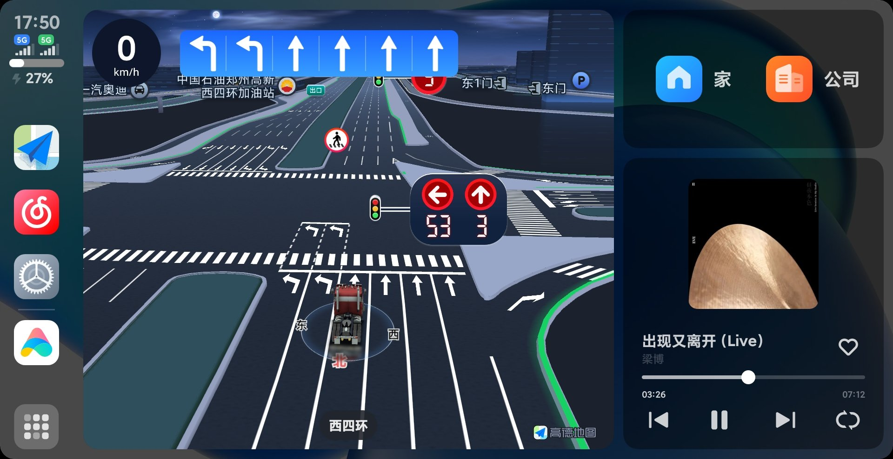
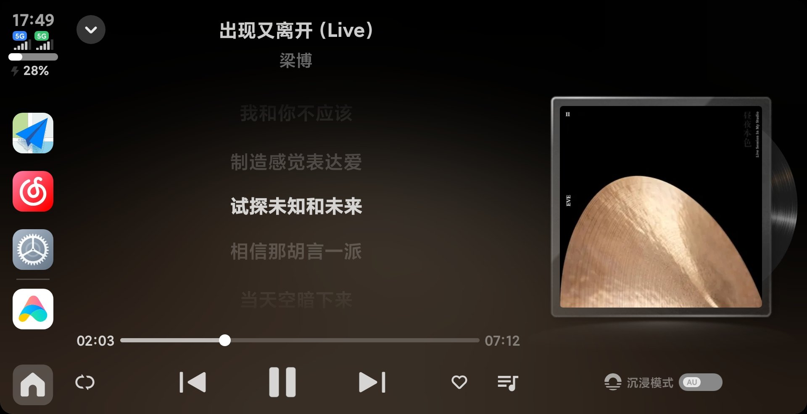
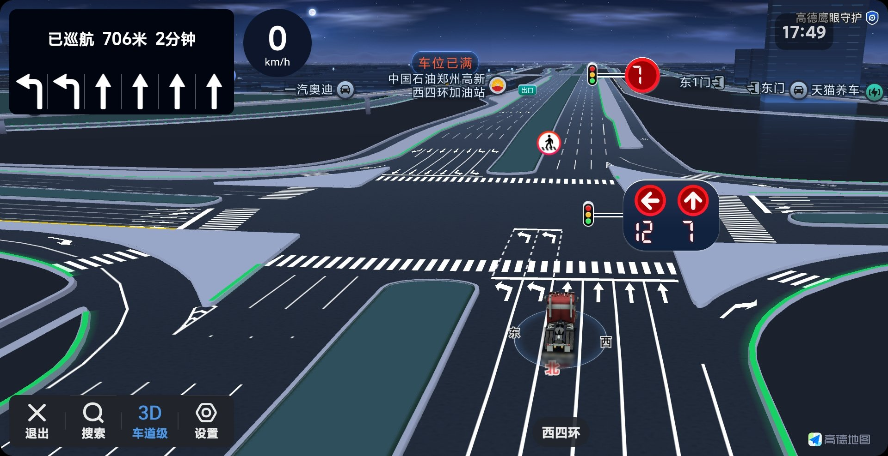

# MiAuto（fork 调整版）

本仓库是 [PiggyBackBayonet/MiAuto](https://github.com/PiggyBackBayonet/MiAuto) 的 fork。
上游 0.1.1 是起点，此后按「**每次真实构建，版本号末位自动 +1**」的节奏逐版调整，
当前版本 **0.1.10**（versionCode 11）。

所有调整都围绕一套**实测环境**展开，并只在该环境上验证：

| 项 | 值 |
| --- | --- |
| 车机 | 比亚迪 宋 Pro DM-i 2022 款 |
| 手机 | 小米 15，澎湃 OS 4（CarWith / 小米车联） |
| 面板 | 实测刷新率 **57.999996 Hz**（不是 60） |
| 链路 | ICCOA CarLink，**P2P-only**（不声明 SoftAP），BLE 广播 + Wi-Fi Direct |
| 车机端包名 | `com.miauto.app`（debug 共存包 `com.miauto.app.debug`） |

下载页：<https://mlzhuo.github.io/MiAuto/> · 源码与发布：<https://github.com/mlzhuo/MiAuto>

---

## 一、目前的调整结果

一句话概括：**车机通电自己把应用起起来 → 手机不用解锁就能被发现 → 自动连上 → 导航语音和音乐同时放 → 方向盘切歌正常 → 地图基本不卡。**

下面第 4、6 节附**车机屏实拍截图**（1920×988 面板）。

### 1. 车机端自启动

车机通电后 MiAuto 自己起来并开始广播，**不需要人在车机上点任何东西**。

链路：

```
BOOT_COMPLETED / LOCKED_BOOT_COMPLETED / QUICKBOOT_POWERON / MediaTek BOOT_IPO
  / FYT·GLSX·Microntek ACC_ON …
        └─> BootCompleteReceiver（directBootAware）
              └─> startForegroundService(AapService, EXTRA_BOOT_START)
                    └─> launchMainActivityOnBoot()
                          ├─ Android < 10：直接 startActivity
                          ├─ Android 10+：悬浮窗 trampoline（有 SYSTEM_ALERT_WINDOW 时）
                          └─ 兜底：全屏 Intent 通知
                                └─> MainActivity → ensureIcocaStarted() → BLE 开始广播
```

前置条件（缺一项则退化为「不自动启动」）：

- 设置里打开 **开机自启动**（`Settings.autoStartOnBoot`，会同步到 device-protected storage，
  这样锁屏态的 boot receiver 也能读到）；
- Android 10+ 授予 **悬浮窗** 权限，否则只能走全屏通知兜底（需要用户点一下）；
- 车机 **忽略电池优化**（实测车机已处于 exempt 状态）。

实测车机日志可佐证：`Boot auto-start` × 9、`App launched via …` × 3、
`Battery optimization exempt` × 3、`Boot WakeLock acquired (10min timeout)` × 3。

### 2. 手机无需解锁

配对与回连全部发生在系统层（BLE 广播 + P2P 协商），**不要求解锁手机、不要求打开
CarWith、不要求在手机上点确认**。

车机侧唯一要做对的事是「**一直可被发现**」，这由三件事保证：

| 机制 | 行为 |
| --- | --- |
| 30 秒重播看门狗 | 未连接时每 30 秒「停-启」一次广播。BLE 广播帧内容不变时手机不会重新发现车机，所以必须停-启，而不是重复 `startAdvertise()` |
| 会话结束自动重播 | 手机断开后 1.2 秒自动重播，手机重新发现车机并下发**新的**配对码 |
| 手动刷新 | 待机页的刷新按钮立刻重播一次，不必等满 30 秒 |

看门狗在「手机正在连接 / 已连上 / 正在投屏」时一律让位，绝不打断进行中的会话；
新配对码下发时计时重置，保证用户有完整的 30 秒去确认。

### 3. 无感连接

首配之后，日常使用没有任何人工步骤：

1. 车机持续广播 → 手机端 CarWith 自动发现这台车（信任设备表由 ICCOA SDK 维护）；
2. 协商进度 0 → 100，链路建立；
3. 车机检测到会话已建立 → **自动拉起投屏页**（`IcocaProjectionActivity`），不需要用户再点一次「连接」；
4. 会话结束（手机断开 / 车机侧点「断开」）→ 车机保持广播 → 手机下一次自己回来。

实测车机日志里这一整轮是连着跑完的：

```
ICCOA projection: disconnect tapped
ICCOA: === 断开当前会话（保持广播）===
ICCOA: WifiLock released
ICCOA: 会话结束 → 重新广播（等待手机再次连接，届时下发新的配对码）
ICCOA: ✓ startAdvertise() = true
ICCOA: ★ onPinCode pinCode=292902 carDeviceName=MiAutoCar
ICCOA: WifiLock acquired (LOW_LATENCY)
ICCOA: onConnectingProgress 10 … 100
ICCOA: cast started
```

投屏期间车机与手机之间是**双向**的：画面从手机过来，触摸坐标按 SDK 的显示区尺寸缩放后
经 UIBC 通道回传（`forwardTouch`），方向盘媒体键也转给手机（见下文 0.1.5）。

### 4. 导航和音乐不冲突

手机上的**导航语音和背景音乐可以同时播放**，互不打断，导航播报结束后音乐继续。

这一条是分两步修好的：

| 版本 | 改动 | 解决的现象 |
| --- | --- | --- |
| 0.1.4 | 每种 AudioType 各自构造音频焦点属性 | 导航提示音先拿到焦点后，音乐播放器不再自己申请焦点，音频被静默丢弃 —— 现象是「画面正常、进度正常、就是没声音」 |
| 0.1.5 | 焦点永久丢失后重新武装 SDK 的焦点申请 | SDK 的 GAIN 焦点每个播放器只申请一次，永久丢焦后不再申请，之后每一帧 PCM 都被丢弃，只有断开重连才恢复 |

实测车机屏（1920×988 面板，以下均为实拍）：

**导航与音乐同屏**：左边导航跑 3D 车道级，右下角音乐卡片的进度条同时在走 ——
导航语音播报时背景音乐继续放，没有被抢焦点。



**音乐全屏播放**：网易云音乐在车机上直接播放，播放 / 暂停 / 上一曲 / 下一曲都在。



### 5. 方向盘切歌正常

方向盘上的**上一曲 / 下一曲 / 播放暂停**会透传到手机，车机自己不再抢。

SDK 只搬运手机的音视频，按键必须由车机显式经控制通道回传。此前按键被车机自带的
音乐/收音机吃掉，它们抢到音频焦点后 SDK 反而给手机发暂停，用户看到的就是
「**切歌变成暂停**」。切换键没有对应键码，按手机当前是否在放音解析成显式 PLAY / PAUSE，
并在按下的瞬间整组下发（0.1.5）。

### 6. 地图掉帧基本解决

掉帧有两个来源，车机侧与手机侧各一个，两边都处理掉之后地图已能基本流畅：

| 来源 | 处理 | 版本 |
| --- | --- | --- |
| P2P 空闲窗口里系统省电降低射频占空比，视频成串到达再成串卡住 | 投屏期间持有 Wi-Fi 锁（Android 10+ 用 `WIFI_MODE_FULL_LOW_LATENCY`） | 0.1.8 / 0.1.9 |
| 面板 57.999996 Hz 与手机端帧率不匹配：CarWith 设 30fps 时 58/30 ≈ 1.93，落成 2-2-1 的输出节奏 | 车机侧向手机声明 `fps=58`；**手机端把 CarWith 帧率调到 60**（分辨率标准或高清即可） | 0.1.6 |

实测车机屏（1920×988 面板）导航 3D 车道级渲染：转向箭头、路口放大、巡航信息与红绿灯读秒齐全，
画面已经能跟手，不再成串卡顿。



---

## 二、逐版调整记录

| 版本 | versionCode | 日期 | 构建标记 | 调整内容 |
| --- | --- | --- | --- | --- |
| 0.1.1 | 2 | 2026-10-13 | — | **上游基线**，本 fork 未改动（DiAuto Pro 血统 + ICCOA CarLink + 30 秒看门狗） |
| 0.1.2 | 3 | 2026-10-20 | `2026-10-20e` | 启用自动版本号（`version.properties`，每次真实构建末位 +1、versionCode +1）；P2P-only；progress=100 判定已连接；触控回传；Surface 重绑；音频焦点重试 |
| 0.1.3 | 4 | 2026-10-20 | `2026-10-20e` | 构建产物命名统一为 `com.miauto.app.debug_<版本>.apk`（去掉重复的 `_debug_debug` 后缀）；构建脚本按 `version.properties` 精确定位产物 |
| 0.1.4 | 5 | 2026-10-20 | `2026-10-20f` | **每种 AudioType 使用独立的音频焦点属性**：不再让所有音源共用 SDK 默认属性，避免通知音先拿焦点后音乐被静默丢帧 |
| 0.1.5 | 6 | 2026-10-20 | `2026-10-20g` | **方向盘媒体键透传到手机**；会话存续期由 MiAuto 自己的 MediaSession 接管按键；**焦点永久丢失后重新武装** SDK 的焦点申请；改用 AOSP testkey 签名（可覆盖安装） |
| 0.1.6 | 7 | 2026-10-21 | `2026-10-20g` | **5G 信道白名单**：车机 STA 信道排在允许列表首位，列表非空（避免 SDK 回退到 165 再分时）；**fps 改为 58**，与 57.999996 Hz 面板对齐 |
| 0.1.7 | 8 | 2026-10-21 | `2026-10-21a` | 构建标记随 0.1.6 的改动一起升级（记录 `wifi-channel-align` / `fps58` 已进包），功能与 0.1.6 相同 |
| 0.1.8 | 9 | 2026-10-21 | `2026-10-21b` | **投屏期间持有 Wi-Fi 锁**（Android 默认省电会在 P2P 空闲窗口降低射频占空比，视频成串到达再成串卡住）——ICCOA 链路此前漏了 AA 链路一直有的这一步 |
| 0.1.9 | 10 | 2026-10-21 | `2026-10-21b` | Wi-Fi 锁在 Android 10+ 改用 `WIFI_MODE_FULL_LOW_LATENCY`（HIGH_PERF 在 Android 10 已弃用且可能被系统忽略） |
| 0.1.10 | 11 | 2026-10-21 | `2026-10-21b` | **首次发布版**：代码与 0.1.9 相同，改用本 fork 自己的发布密钥（`com.miauto.app`，非 debug 共存包）出包并挂到 Releases；当前版本 |

> 构建标记写在 `IccoaManager.start()` 的启动日志里，装完车机看一眼日志即可确认装的是哪一版：
> `ICCOA: 构建标记 2026-10-21b：P2P-only / progress100 / touch / surface-rebind /
> audio-focus-per-type / media-key-forward / focus-loss-rearm / wifi-channel-align /
> wifi-lock / fps58`

### 各版为什么这么改

**P2P-only（0.1.2）** — 侧载 APK 拿不到 `TETHER_PRIVILEGED` / `OVERRIDE_WIFI_CONFIG` /
`NETWORK_SETTINGS`（都是 signature|privileged），SDK 的 `WifiApService` 起不来；而配置里只要
声明「支持 SoftAP」，手机就优先选 AP 通道，协商会**永远停在 10%**。只宣称 P2P 才能走通。

**progress=100 判定已连接（0.1.2）** — 部分手机只把连接状态打成 `-1` 这类过渡值。只看状态码，
投屏页（唯一提供 Surface 的地方）永远不会打开。以协商进度 100 为准，并允许导航数据到达
作为「会话确实存在」的旁证。

**触控回传（0.1.2）** — SDK 只把画面投到 Surface 上，看不见车机面板，没有回传就是单向镜像。
触摸坐标按 SDK 声明的显示区尺寸换算后经 UIBC 通道发回。

**Surface 重绑（0.1.2）** — Surface 被换掉时必须先 `pauseCast()`：SDK 的解码器绑在具体那块
BufferQueue 上，旧 Surface 销毁后继续写帧会报 `queueBuffer -19`，视频永久黑屏但声音还在。

**音频焦点（0.1.4 / 0.1.5）** — SDK 用 `focusGain_usage_contentType` 作焦点状态的 key，
监听器返回 null 时所有音源拿到同一组默认属性，于是共用一个焦点状态：通知音先拿到焦点后，
随后创建的音乐播放器只蹭这个状态、不再自己申请，通知一结束音乐就被静默丢帧（现象是
「画面和进度正常、没声音」）。另外 SDK 的 GAIN 焦点每个播放器只申请一次，永久丢焦后
它不会再申请，之后每一帧 PCM 都被丢弃——只有断开重连才恢复。所以要按 AudioType 分属性，
并在丢焦后重新武装申请。

**媒体键透传（0.1.5）** — SDK 只搬运手机的音视频，按键必须由车机显式经控制通道回传。
不传的话按键被车机自带的音乐/收音机吃掉，它们抢到音频焦点后 SDK 会给手机发暂停，
用户看到的就是「切歌变成暂停」。切换键没有对应键码，按手机当前是否在放音解析成显式
PLAY / PAUSE，并在按下的瞬间整组下发。

**5G 信道与 fps（0.1.6）** — P2P 组与 STA 用不同信道时，Wi-Fi 芯片只能分时切换；
把车机信道放在允许列表首位可以避免这一层分时。fps 请求 58 是为了对齐 57.999996 Hz 的面板。

---

## 三、与上游 0.1.1 的差异（文件级）

```
app/build.gradle.kts                                     自动版本号；APK 产物命名
version.properties                                       新增：版本号唯一来源
app/src/main/java/com/miauto/app/IccoaManager.java        ICCOA 生命周期与配置（本次改动的主体）
app/src/main/java/com/andrerinas/openheadunit/connection/IcocaBridge.kt
                                                          媒体会话、progress/错误码、MusicInfo
app/src/main/java/com/andrerinas/openheadunit/icoca/IcocaProjectionActivity.kt
                                                          触控回传、Surface 销毁处理
app/src/main/java/com/andrerinas/openheadunit/connection/CarKeyReceiver.kt
                                                          媒体键转手机
app/src/main/java/com/andrerinas/openheadunit/main/HomeFragment.kt
                                                          待机页显示协商错误码
app/src/main/java/com/andrerinas/openheadunit/aap/NativeGroupFrequencyPolicy.kt
                                                          5G 信道白名单（+ 对应单测）
```

---

## 四、构建

需要 JDK 17、Android SDK 36、NDK `29.0.14206865`、CMake `3.22.1`。
设置 `ANDROID_HOME` 或未跟踪的 `local.properties`（`sdk.dir=...`）。

```sh
./gradlew :app:testGithubDebugUnitTest :app:assembleGithubDebug :app:assembleGithubRelease
```

APK 产物在 `app/build/outputs/apk/github/`。

### ICCOA SDK dex 不在仓库里

ICCOA CarLink 协议层是**预编译的专有二进制**（`app/libs/icar-sdk.dex`，约 7.1 MB），
既不随本仓库分发，也不受本项目的 AGPL-3.0 许可覆盖。仓库里只有编译期用的签名桩
`app/stubs/icar-sdk-stubs.jar`（`compileOnly`，不会进 APK）。

没有 SDK dex 时构建照样成功，但产出的 APK **没有任何 CarLink 能力**；带上 dex 时
`injectIccoaDex` 会把它追加为下一个空闲的 `classesN.dex`，再 zipalign 并重新签名
（写 zip 会作废 AGP 的签名）。该任务幂等：重复构建不会把 APK 越塞越大。
详见 [app/libs/README.md](app/libs/README.md)。

### 版本号自动递增

`version.properties` 是版本号的唯一来源：

```properties
versionName=0.1.10
versionCode=11
```

`app/build.gradle.kts` 在**真正执行 assemble/install/build 时**把末位与 versionCode 各 +1
并写回该文件；IDE 同步、`compile`、`test` 不会触发自增。

### 签名

Release 变体需要一份不入库的 `key.properties`（仓库根目录，已被 `.gitignore` 忽略）：

```properties
storeFile=/absolute/path/to/miauto-release-key.jks
storePassword=YOUR_PRIVATE_PASSWORD
keyAlias=miauto
keyPassword=YOUR_PRIVATE_PASSWORD
```

`storeFile` 可写绝对路径，也可相对仓库根或 `app/` 模块，两种都会被尝试。
本 fork 的发布版用**自己的发布密钥**签名（与上游 MiAuto 的密钥不同，因此无法覆盖安装
上游的包；同 fork 的各版本之间可以互相覆盖）。密钥与口令请自行备份 —— 丢了就只能让用户
卸载重装。

---

## 五、已知问题

**地图掉帧（已基本解决，残留一个前提）** — 根因有两个：车机侧在 P2P 空闲窗口被系统省电
降低了射频占空比，视频成串到达再成串卡住（0.1.8 持有 Wi-Fi 锁解决）；面板 57.999996 Hz 与
手机端帧率不匹配（CarWith 设 30fps 时 58/30 ≈ 1.93，落成 2-2-1 的输出节奏）。
**请把 CarWith 帧率调到 60**（分辨率保持标准或高清即可），车机侧从 0.1.6 起已经向手机声明
`fps=58` —— 两边都到位后地图已能基本流畅，但把 CarWith 调回 30fps 会重新出现固有的节奏不匹配。

**未验证项** — 仪表盘镜像与 HUD 导航输出沿用上游实现，在本 ICCOA 链路上**尚未验证**；
`ICCOA_ONLY` 构建下 Android Auto 侧的逻辑被整体旁路，仅保留前台保活。

---

## 六、原仓库与许可

本仓库 fork 自：

- **[PiggyBackBayonet/MiAuto](https://github.com/PiggyBackBayonet/MiAuto)** — 上游原仓库，
  MiAuto 0.1.0 / 0.1.1 由此发布。本 fork 的全部改动都是在其之上追加的。

上游血统（沿用其构建产物与致谢）：

- [DiAuto Pro](https://github.com/zutaozhong-hash/DiAuto-Pro)
  → [DiAuto](https://github.com/shihabal3amri/DiAuto)
  → [Open Headunit](https://github.com/andreknieriem/open-headunit)
  → [Michael Reid](https://github.com/mikereidis/headunit)

许可：**AGPL-3.0**，见 [LICENSE](LICENSE) 与
[COPYRIGHT_MICHAEL_REID_GPLv3AFFERO.txt](COPYRIGHT_MICHAEL_REID_GPLv3AFFERO.txt)。
本仓库包含已发布应用的源码。

本项目是独立社区项目，**与小米、OPPO、vivo、ICCOA、Google、比亚迪无隶属、授权或背书关系**。
Android Auto、CarWith、车联、Jovi InCar 及文中提及的产品与公司名称均为各自权利人的商标。

> ICCOA SDK dex 为来源无授权的专有二进制，仅在构建时本地使用，**不随本仓库分发**。
